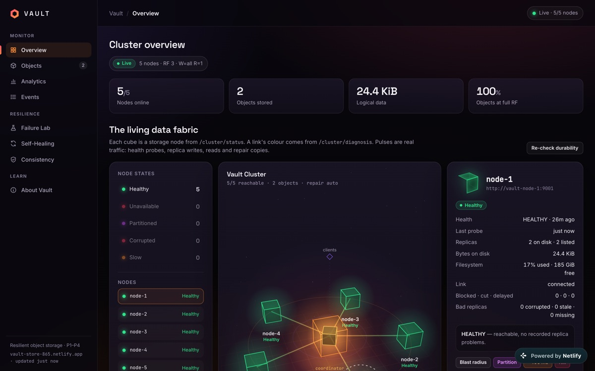

### About me

Computer Science student at **Lovely Professional University**, based in Hyderabad. I build products end to end: the backend that does the real work, a frontend people enjoy using, and the pipeline that ships it. Most of my time lately goes into **cloud and DevOps**, and into putting **AI** to work on problems that are actually annoying.

- 🚀 Every project below is deployed. Click **Live** and try it.
- ☁️ Comfortable across AWS, Docker, CI/CD and Linux, not just application code.
- 🧠 Smart India Hackathon: built an explainable diabetic retinopathy screening system.
- 📚 Solving DSA in C++ daily. A Chrome extension I wrote commits every accepted LeetCode solution for me.

---

### ⭐ Featured work

<table>
<tr>
<td width="50%" valign="top">

#### [Zenkai](https://github.com/ganesh-tadigadapa/Zenkai)
Pulls internships, hackathons, scholarships and certifications from **20+ official sources every 6 hours**, then ranks them for each student.

`Next.js` `FastAPI` `PostgreSQL` `GitHub Actions`

[**Live →**](https://getzenkai.vercel.app) · [Code](https://github.com/ganesh-tadigadapa/Zenkai)

</td>
<td width="50%" valign="top">

#### [RetinaX](https://github.com/ganesh-tadigadapa/retinaX)
Diabetic retinopathy screening from fundus photos. It gives a severity grade with a **Grad-CAM explanation** and produces PDF reports for doctors. Built for Smart India Hackathon.

`TensorFlow` `EfficientNetV2` `FastAPI` `Next.js` `Docker`

[Code](https://github.com/ganesh-tadigadapa/retinaX)

</td>
</tr>
<tr>
<td width="50%" valign="top">

#### [Vautify](https://github.com/ganesh-tadigadapa/vautify)

A distributed object store in **Go**. It verifies every byte on read with checksums, replicates across nodes and **repairs itself** when one fails. The demo runs a real 5-node cluster.

`Go` `Distributed systems` `Replication`

[**Live →**](https://vault-store-865.netlify.app) · [Code](https://github.com/ganesh-tadigadapa/vautify)

</td>
<td width="50%" valign="top">

#### [Splitly](https://github.com/ganesh-tadigadapa/Splitly)
Group expense splitter that settles everyone up in the fewest payments. It uses **Gemini** to read receipt photos and turn plain-English sentences into expenses.

`React` `Express` `MongoDB` `JWT` `Gemini`

[**Live →**](https://splitly-pied.vercel.app) · [Code](https://github.com/ganesh-tadigadapa/Splitly)

</td>
</tr>
<tr>
<td width="50%" valign="top">

#### [Assignment system on AWS](https://github.com/ganesh-tadigadapa/assignment_aws)
Production-style AWS setup, defined entirely in **CloudFormation**: EC2 behind a load balancer with auto scaling, RDS MySQL, S3, Lambda and CloudWatch.

`AWS` `CloudFormation` `EC2` `RDS` `Lambda`

[Code](https://github.com/ganesh-tadigadapa/assignment_aws)

</td>
<td width="50%" valign="top">

#### [Zekrom](https://github.com/ganesh-tadigadapa/Zekrom)
Converts up to **30 files at once** (documents, slides, sheets, images, PDFs) and gives them back as one zip. No sign-up, no one-file-at-a-time.

`Python` `Docker` `Render`

[**Live →**](https://zekrom-09tu.onrender.com) · [Code](https://github.com/ganesh-tadigadapa/Zekrom)

</td>
</tr>
</table>

<b>More projects</b>

 

| Project | What it is | |
|---|---|---|
| [Thread Visualizer](https://github.com/ganesh-tadigadapa/thread_visualize) | Browser simulator showing how an OS schedules threads on CPU cores and syncs them | [Live](https://threadvisualize.netlify.app) |
| [LPU Nexus](https://github.com/ganesh-tadigadapa/lpu-nexus) | One page for LPU students: campus services, food courts, a CGPA/SGPA calculator | [Live](https://lpunexus.netlify.app) |
| [NightShift](https://github.com/ganesh-tadigadapa/NightShift) | Chrome extension that gives any website a readable, low-glare dark theme | |
| [LeetCode Sync](https://github.com/ganesh-tadigadapa/Leetcode_extension) | Chrome extension that auto-commits accepted LeetCode solutions to GitHub | |
| [LPU Auto Connect](https://github.com/ganesh-tadigadapa/lpu-auto-connect) | Chrome extension that logs in to the campus Wi-Fi portal automatically | |
| [DSA_007](https://github.com/ganesh-tadigadapa/DSA_007) | Daily DSA practice in C++: LeetCode and Striver sheet | |

---

### 🛠️ Tech stack

   
   
   
  

| | |
|---|---|
| **Languages** | C++ · Python · Go · TypeScript · JavaScript · SQL |
| **Backend** | FastAPI · Node.js / Express · REST APIs |
| **Frontend** | React · Next.js · Tailwind CSS |
| **Data & AI** | PostgreSQL · MySQL · MongoDB · TensorFlow · Gemini API |
| **Cloud & DevOps** | AWS · Oracle Cloud · Docker · GitHub Actions · Linux · Vercel · Render · Netlify |

---

**Open to internships and collaborations.** The fastest way to reach me is [LinkedIn](https://linkedin.com/in/ganesh-tadigadapa) or [email](mailto:ganeshtadigadapa1@gmail.com).

